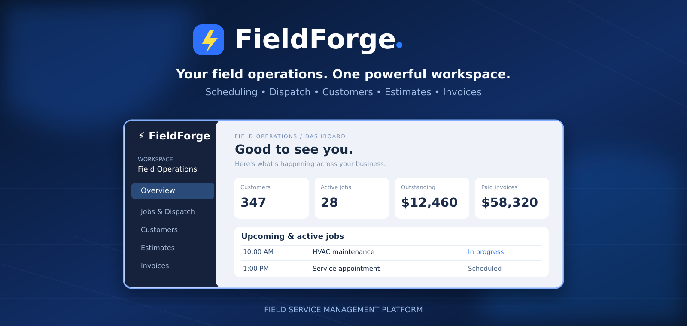

# ⚡ FieldForge




**Field-service command center for home-service businesses.** A working self-hosted, multi-tenant SaaS MVP.

## Included

- Company registration and seven-day signed login sessions
- Separate company data; owner, dispatcher and technician roles
- Customers, search and editing
- Job scheduling, crew assignment, status updates and responsive technician view
- Estimates and invoices with manual status tracking and print-friendly documents
- Revenue and scheduling summary cards
- Mobile responsive interface, FastAPI JSON API, Docker Compose, persistent SQLite database

## Not included yet

No automatic payments, Stripe integration, AI phone receptionist, SMS, emails, GPS tracking, recurring billing, tax calculation, webhook processing, password reset, invitations, MFA or audited production deployment. Invoice paid status is a **manual bookkeeping status**, not payment verification. This is an MVP, not production-ready payment or accounting software.

## Deploy on your Linux server

```bash
unzip fieldforge-mvp.zip
cd fieldforge
cp .env.example .env
# Generate a stable signing secret, replacing the placeholder in .env:
python3 - <<'PY'
from pathlib import Path
import secrets
p=Path('.env')
s=p.read_text().replace('REPLACE_WITH_A_RANDOM_SECRET', secrets.token_urlsafe(48))
p.write_text(s)
PY
docker compose up -d --build
docker compose ps
```

The default Compose port is **127.0.0.1:8125**, intentionally bound to loopback only. Open from another machine through an SSH tunnel:

```bash
ssh -L 8125:127.0.0.1:8125 yeet
```

Then visit http://127.0.0.1:8125 on the machine where you ran the SSH tunnel. For a public HTTPS URL, configure Caddy to reverse proxy a domain to `127.0.0.1:8125` on the Docker host and protect onboarding as appropriate. **Do not simply expose port 8125 to the public internet.**

### Local non-Docker development

```bash
python3 -m venv .venv && source .venv/bin/activate
pip install -r requirements.txt
export DATABASE_PATH="$PWD/dev.db"
export APP_SECRET="$(python3 -c 'import secrets;print(secrets.token_urlsafe(48))')"
uvicorn app.main:app --reload
```

### Tests

```bash
pytest -q
```

### Data, backups and security

Database is in a named Docker volume `fieldforge_data`. Make regular backups with a SQLite online backup operation while the service is running. Keep `.env` secret and maintain the same APP_SECRET across restarts or users will be logged out. On first deployment use HTTPS, restrict access, and implement password-reset/MFA/rate limiting, audit logs, CSRF-resistant cookie auth, session revocation, and monitoring before real commercial use. For serious multi-user production scale, migrate to PostgreSQL and a managed hosting provider.

## Suggested future roadmap

1. Postgres, migrations, background tasks, email verification/password reset, rate limits.
2. Public customer portal, quote approval, invoice email and Stripe Checkout with verified webhooks.
3. Twilio texting, opt-in management and notifications.
4. AI call handling with call consent, human handoff and booking confirmation.
5. Repeat jobs, GPS route planning, mobile offline support, reporting and subscription billing.

FieldForge is an independent original MVP, not a copy of any other company's proprietary software or branding.

## v0.2 update — operations tools

New in v0.2: month-view dispatch calendar, service catalog with standard prices and estimated durations, and per-job notes with author history (including technician notes restricted to assigned jobs). The new tables are created automatically on startup. Existing customers, team members, jobs, estimates, and invoices are preserved if the existing Docker named volume is kept.

To upgrade an existing installation on yeet, first back up the existing SQLite database while the container is stopped:

```bash
cd ~/fieldforge
docker compose stop web
docker compose run --rm --no-deps --entrypoint sh web -c 'cp /data/fieldforge.db /data/fieldforge-pre-v02.db && ls -lh /data/fieldforge-pre-v02.db'
```

Then extract the updated source into `~/fieldforge` (do not delete the directory, run `docker compose down -v`, or replace `.env`), and restart:

```bash
cd ~/fieldforge
docker compose up -d --build
docker compose ps
```

Note: the backup inside the same Docker volume is convenient for rollback but is not an off-server disaster recovery backup. Make an off-host backup before making this available to paying customers.
